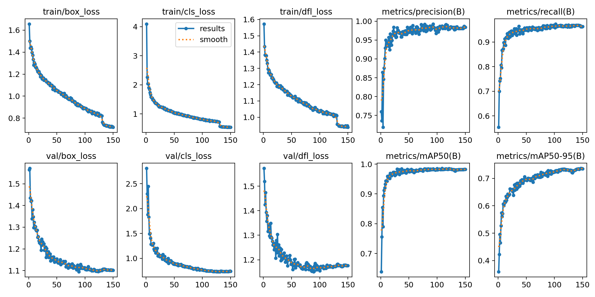
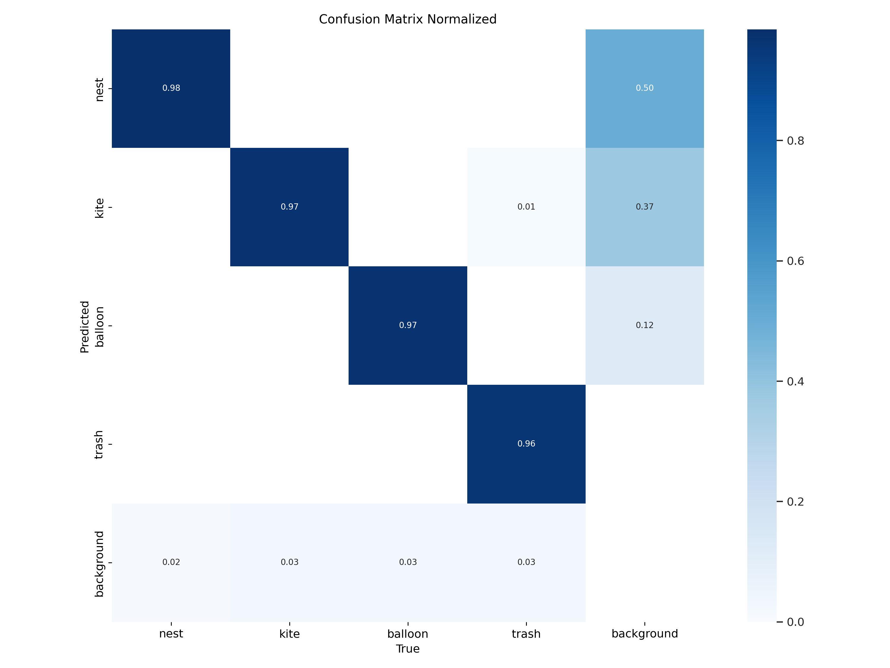
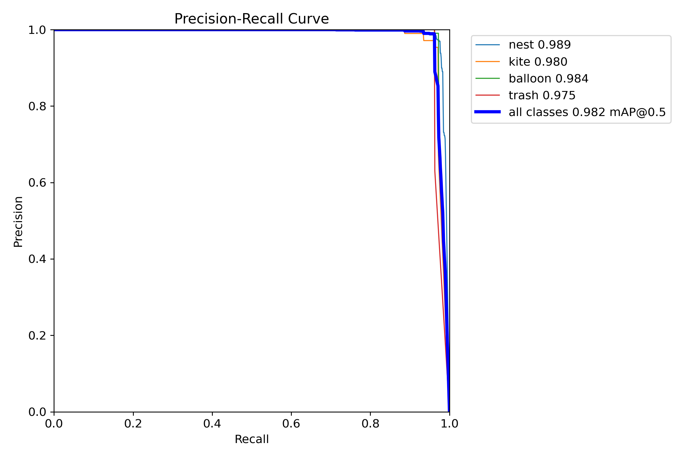

# 输电线路异物检测训练记录（2026-09-29）

本仓库保存 2026-09-28 至 2026-09-29 在 GPU 服务器上完成的两轮 YOLOv8 训练：原始划分基线，以及按类别分层重划后的可用模型。

数据集来源：[codeshuai-001/dataset_26-9-26](https://github.com/codeshuai-001/dataset_26-9-26)  
任务：检测输电线路异物，4 类 `nest` / `kite` / `balloon` / `trash`。

## 结论

原始仓库划分把全部 `kite`、`trash` 放进验证集，训练集里这两类一张都没有，所以基线模型不能用。

按类别做 80/20 分层重划后，用 YOLOv8s 训练 150 轮，验证集四类均可检出：

| 实验 | 模型 | 划分 | 轮次 | mAP50 | mAP50-95 | Precision | Recall |
|---|---|---|---:|---:|---:|---:|---:|
| 基线 | YOLOv8n | 原始划分 | 第 44 轮最好 | 0.394 | 0.160 | 0.572 | 0.262 |
| 重训 | YOLOv8s | 分层 80/20 | 第 147 轮最好 | **0.982** | **0.737** | **0.985** | **0.962** |

最终权重：[`results/balanced_yolov8s/weights/best.pt`](results/balanced_yolov8s/weights/best.pt)

## 环境

| 项 | 值 |
|---|---|
| 服务器 | Ubuntu 22.04.3 LTS，主机名 `ubuntu22` |
| GPU | Tesla V100-SXM2-32GB（32 GB） |
| 驱动 / CUDA | NVIDIA 550.127.05 / CUDA 12.4 |
| Python | 3.10.12（`/root/AKCMamba_YOLO/venv`） |
| PyTorch | 2.5.1+cu121 |
| Ultralytics | YOLOv8.1.0 |
| 训练占用 | 约 7.5 GB 显存，GPU 利用率约 80%–96% |

代码目录：`/root/AKCMamba_YOLO`  
项目骨架是 AKCMamba_YOLO，这两轮实际训练的是官方 YOLOv8 权重，没有启用自定义 Mamba 结构。

## 数据集问题

原始 yaml：`configs/tlfo.yaml`  
路径：`/root/AKCMamba_YOLO/datasets/tlfo`（指向 GitHub 数据集目录）

原始划分按文件名堆叠，不是按类别切分：

| 划分 | 图像数 | nest | kite | balloon | trash |
|---|---:|---:|---:|---:|---:|
| train | 2297 | 1967 | **0** | 364 | **0** |
| val | 2219 | 992 | **527** | 189 | **539** |

训练集从未见过风筝和垃圾，验证集却要求检测这两类。训练损失下降、验证损失几乎不动，符合这个泄漏方式。

## 修复：分层重划

脚本：[`scripts/resplit_dataset.py`](scripts/resplit_dataset.py)

规则：

- 合并原始 train/val 的 4516 张图
- 按每张图主类别分层
- 80% 训练 / 20% 验证，`seed=42`
- 检查 train/val 文件名无重叠
- 输出到 `/root/AKCMamba_YOLO/datasets/tlfo_balanced`

重划后实例数：

| 划分 | 图像数 | nest | kite | balloon | trash |
|---|---:|---:|---:|---:|---:|
| train | 3612 | 2365 | 421 | 445 | 431 |
| val | 904 | 594 | 106 | 108 | 108 |

对应 yaml：[`configs/tlfo_balanced.yaml`](configs/tlfo_balanced.yaml)

验证集 `nest_8.jpg` 有 1 条重复标注，Ultralytics 扫描时已去掉。

## 实验 1：原始划分基线（不可用）

- 时间：2026-09-28 18:07:52 → 18:40:29 CST
- 脚本：[`scripts/train_server.py`](scripts/train_server.py)、[`scripts/start_train.sh`](scripts/start_train.sh)
- 模型：`yolov8n.pt`，约 3.0 M 参数，8.2 GFLOPs
- 设置：100 轮，`batch=32`，`imgsz=640`，`patience=50`，`optimizer=auto`，`lr0=0.01`，`close_mosaic=10`
- 实际：第 44 轮最好，第 94 轮早停，用时 0.531 小时

`best.pt` 各类结果：

| 类别 | 实例 | Precision | Recall | mAP50 | mAP50-95 |
|---|---:|---:|---:|---:|---:|
| all | 2246 | 0.572 | 0.262 | 0.395 | 0.160 |
| nest | 991 | 0.958 | 0.504 | 0.644 | 0.314 |
| kite | 527 | 1.000 | 0.000 | 0.501 | 0.150 |
| balloon | 189 | 0.331 | 0.545 | 0.433 | 0.177 |
| trash | 539 | 0.000 | 0.000 | 0.000 | 0.000 |

`kite` 召回为 0，`trash` 全 0。曲线和混淆矩阵见 [`results/baseline_yolov8n/plots/`](results/baseline_yolov8n/plots/)。

## 实验 2：分层划分 + YOLOv8s（可用）

- 时间：2026-09-29 18:46:35 → 19:56:19 CST
- 脚本：[`scripts/train_balanced.py`](scripts/train_balanced.py)、[`scripts/start_train_balanced.sh`](scripts/start_train_balanced.sh)
- 模型：`yolov8s.pt`，约 11.1 M 参数，28.7 GFLOPs
- 设置：150 轮，`batch=32`，`imgsz=640`，`patience=40`，AdamW，`lr0=0.001`，余弦学习率，`close_mosaic=20`，`mixup=0.1`，`copy_paste=0.1`，`cls=1.0`
- 实际：跑满 150 轮，用时 1.152 小时
- GPU：训练中约 80%–96% 利用率，显存约 7560 MiB / 32768 MiB

关键节点：

| 轮次 | mAP50 | mAP50-95 | 说明 |
|---:|---:|---:|---|
| 1 | 0.639 | 0.359 | 第 1 轮已超过原基线 |
| 5 | 0.894 | 0.527 | 四类开始同时有分数 |
| 21 | 0.966 | 0.662 | 进入可用区间 |
| 63 | 0.980 | 0.707 | 高位震荡 |
| 89 | 0.984 | 0.729 | 当时最优 |
| 109 | **0.986** | 0.731 | mAP50 最高 |
| 147 | 0.982 | **0.737** | mAP50-95 最高，保存为 `best.pt` |
| 150 | 0.982 | 0.736 | 最后一轮 |

`best.pt` 最终验证（第 147 轮权重）：

| 类别 | 图像 | 实例 | Precision | Recall | mAP50 | mAP50-95 |
|---|---:|---:|---:|---:|---:|---:|
| all | 904 | 915 | 0.985 | 0.962 | 0.982 | 0.737 |
| nest | 904 | 593 | 0.978 | 0.967 | 0.989 | 0.732 |
| kite | 904 | 106 | 0.962 | 0.962 | 0.980 | 0.721 |
| balloon | 904 | 108 | 1.000 | 0.955 | 0.984 | 0.776 |
| trash | 904 | 108 | 0.999 | 0.963 | 0.975 | 0.720 |

速度：预处理 0.3 ms，推理 1.0 ms，后处理 0.8 ms（单张，V100）。

曲线、混淆矩阵、训练/验证可视化：[`results/balanced_yolov8s/plots/`](results/balanced_yolov8s/plots/)







## 超参对照

| 项 | 基线 YOLOv8n | 重训 YOLOv8s |
|---|---|---|
| 数据 | `tlfo.yaml` 原始划分 | `tlfo_balanced.yaml` 分层划分 |
| epochs | 100（94 早停） | 150（跑满） |
| patience | 50 | 40 |
| optimizer | auto | AdamW |
| lr0 | 0.01 | 0.001 |
| cos_lr | false | true |
| cls loss 权重 | 0.5 | 1.0 |
| mixup | 0.0 | 0.1 |
| copy_paste | 0.0 | 0.1 |
| close_mosaic | 10 | 20 |
| seed | 0 | 0 |
| imgsz / batch | 640 / 32 | 640 / 32 |

完整参数：[`results/baseline_yolov8n/args.yaml`](results/baseline_yolov8n/args.yaml)、[`results/balanced_yolov8s/args.yaml`](results/balanced_yolov8s/args.yaml)

逐轮指标：[`results/baseline_yolov8n/results.csv`](results/baseline_yolov8n/results.csv)、[`results/balanced_yolov8s/results.csv`](results/balanced_yolov8s/results.csv)

## 仓库结构

```text
README.md
configs/                  数据集 yaml
scripts/                  划分与训练脚本
logs/                     清洗后的训练日志
results/
  baseline_yolov8n/       原始划分，不可用
    args.yaml
    results.csv
    plots/
    weights/best.pt
  balanced_yolov8s/       分层划分，可用
    args.yaml
    results.csv
    plots/
    weights/best.pt
```

本仓库不含原始 5000 张图像，只保存训练配置、日志、曲线和权重。

## 使用最终权重

```bash
from ultralytics import YOLO
model = YOLO("results/balanced_yolov8s/weights/best.pt")
model.predict("your_image.jpg", imgsz=640, conf=0.25)
```

验证：

```bash
yolo detect val \
  model=results/balanced_yolov8s/weights/best.pt \
  data=configs/tlfo_balanced.yaml \
  imgsz=640
```

`configs/tlfo_balanced.yaml` 里的 `path` 需要改成实际数据目录。
